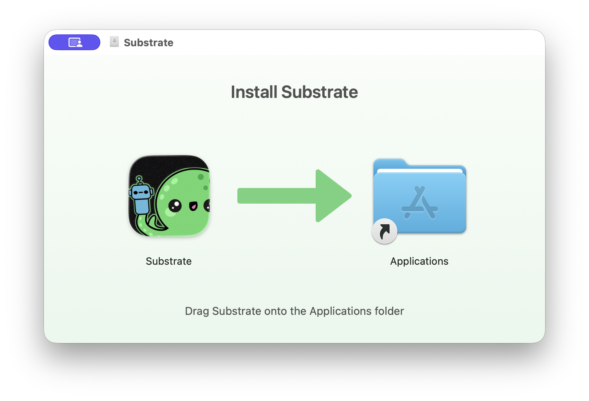

# ate-mac

[](https://opensource.org/licenses/Apache-2.0)



A macOS menu-bar app that runs a local Agent Substrate on kind, inside a Lima
VM it brings along. Personal and experimental. Apple Silicon only.

Actors run under gVisor. The VM has no nested virtualization, so the microVM
sandbox class is not available.

## Build

Needs `limactl`, `docker` (the CLI only), `kubectl`, Go, and Xcode, plus a
Substrate checkout at `../s` (or set `SUBSTRATE_SRC`).

```sh
make image   # slow: builds a VM, installs Substrate into it, exports its disk
make dmg     # builds build/Substrate.app and build/Substrate.dmg
```

`make dmg` scripts Finder to lay out the DMG window, so macOS may ask once to
let your terminal control Finder. Eject any mounted volume named Substrate
first.

`make test` runs the app's unit tests.

`make image` runs the Substrate kind dev flow (`hack/create-kind-cluster.sh`
and `ate-setup deploy ate-system --kind`) against the Docker daemon in a Lima
VM under `build/lima`. It then exports the VM disk as `build/substrate.qcow2`,
converting it in a second, short-lived Lima VM so the host needs no qemu.
`WITH_DEMO=0` leaves out the counter demo. `KEEP_VM=1` keeps the build VM.

The build slims the cluster for a laptop. It removes kind's observability stack
(the otel collector, Prometheus and Jaeger) and turns telemetry export off,
runs one replica of `ate-api-server` and `ate-idp-server`, and deletes the
bucket-init job once it has run. `WITH_OBSERVABILITY=1` keeps the
observability stack.

## Use

Drag `Substrate.app` to Applications. The app is ad-hoc signed, so the first
time, right-click it and choose Open.

Click the menu bar icon to open the status panel:

- The panel shows the VM's CPU and memory, and each pod's health, CPU and
  memory, grouped into Substrate, Workers and Kubernetes. It refreshes every
  2 seconds while open.
- **Start** creates the VM from the bundled image on first use, then boots it.
  The icon fills in once every pod in `ate-system` is healthy.
- **Copy Shell Setup** copies the `KUBECONFIG` and `PATH` exports for
  `kubectl` and the bundled `kubectl-ate`.
- **Restart** stops the VM, forcing it if the guest doesn't shut down, and
  starts it again.
- **Reset** deletes the VM and recreates it from the bundled image. Use it after
  installing a newer build.
- **Settings** sets CPUs and memory (applied on next start) and disk size
  (applied on next reset). The defaults are 4 CPUs, 6 GiB of memory and a
  40 GiB disk. The disk file only grows as the guest uses it.

## Actor example

To build and run your own actor from a Dockerfile, see
[`example/`](example/README.md).